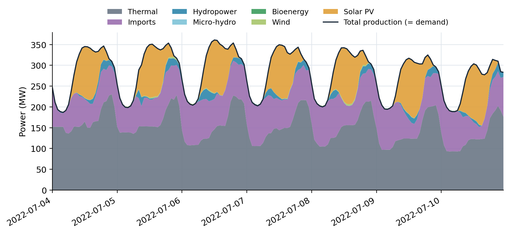
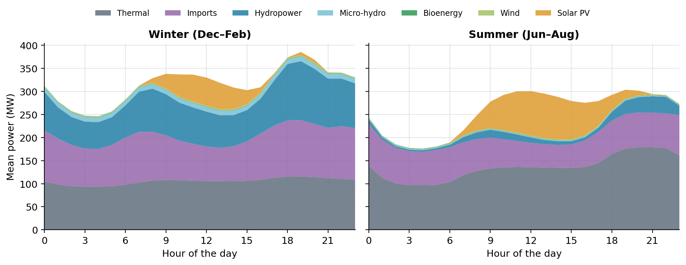
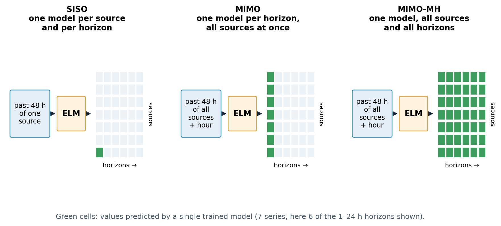

# MIMO-ELM forecasting of the Corsican electricity mix

**Forecast every source of an island grid at once (thermal, imports, hydropower, solar, wind, bioenergy and the total) with Extreme Learning Machines, from EDF open data.**
MATLAB code of the MIMO article, Python code of the multi-horizon extension with reconciliation (MIMO-MH), the hourly data, and figures.

> The repository keeps its original name, `Data_Viz_2024`, because this address is cited in the article.

---

## Articles

**MIMO (published).** C. Voyant, M. Despotovic, L. Garcia-Gutierrez, M. Asloune, Y.-M. Saint-Drenan, J.-L. Duchaud, G. A. Faggianelli, E. Magliaro. *Short-term forecasting of energy production and consumption using extreme learning machine: A comprehensive MIMO based ELM approach.* Applied Energy 410 (2026) 127599. [doi:10.1016/j.apenergy.2026.127599](https://doi.org/10.1016/j.apenergy.2026.127599)

From its abstract: one hour ahead, solar and thermal production are forecast with nRMSE 0.179 and 0.051 and R² > 0.98; total demand stays reliable up to five hours ahead; wind and bioenergy remain hard; MIMO-ELM improves on persistence and on an LSTM tuned with a realistic budget, with small but stable gains over one model per source (SISO), and trains in closed form.

**MIMO-MH (manuscript in submission).** E. Magliaro, C. Voyant, Y. Jheelan, A. Michiorri, A. Julien, Y. Eissa, J. Bright. *Energy-consistent multi-input multi-output multi-horizon extreme learning machines with embedded reconciliation for multi-source power forecasting.* The code is public here; the results will be reported with the article.

## Why forecast all sources together?

On an island grid such as Corsica, production must match consumption at every moment, and there is no large interconnection to absorb errors. The operator needs forecasts of each source **and** of the total, and these forecasts must add up.



**Figure 1.** A week of July 2022. Solar covers the middle of the day; thermal plants and imports through the interconnections follow the evening demand. The sources are not independent: when one varies, others compensate.



**Figure 2.** Mean daily profile in winter and in summer (2016–2022). Hydropower carries the winter evening peak; solar shapes the summer day. A model that sees all sources at once can learn these joint patterns.

## Three ways to organise the models



**Figure 3.** What one trained model predicts.

- **SISO** (single input, single output): one model per source and per horizon, reading only the history of that source. 7 sources × 24 horizons = 168 models, and nothing forces their sum to equal the total.
- **MIMO** (multiple inputs, multiple outputs, the published article): one model per horizon reads the last 48 hours of **all** sources (plus the hour of the day, encoded as sine and cosine) and predicts all of them at once.
- **MIMO-MH** (multi-horizon, the manuscript in submission): a single model predicts all sources for all horizons from 1 to 24 hours, followed by a reconciliation step.

### The Extreme Learning Machine in three lines

1. The inputs go through a hidden layer whose weights are drawn **at random** and never trained.
2. Only the output weights are fitted, by **least squares** (Moore–Penrose pseudo-inverse in the MATLAB scripts, ridge-regularised in the Python pipeline): a closed-form solution, no gradient descent, no epochs.
3. With several outputs, the same hidden layer serves all of them: predicting 7 sources costs almost the same as predicting one.

This is why training takes seconds to minutes on a laptop CPU, which makes frequent retraining possible.

### Reconciliation: making the forecasts add up

Forecasts of the components and of the total are made separately, so they rarely agree. Suppose, for one hour:

| | forecast (MW) | error variance (MW²) |
|---|---:|---:|
| total | 330 | 36 |
| thermal | 150 | 25 |
| imports | 90 | 49 |
| solar | 80 | 100 |

The components sum to 320, not 330. Weighted least-squares (MinT/WLS) reconciliation finds the coherent set of forecasts closest to the original ones, where "close" counts more for the more reliable forecasts:

$$\tilde y = S\,(S^\top W^{-1} S)^{-1} S^\top W^{-1}\,\hat y, \qquad S = \begin{pmatrix}1&1&1\\1&0&0\\0&1&0\\0&0&1\end{pmatrix},\quad W = \mathrm{diag}(36, 25, 49, 100).$$

Result: thermal 151.2, imports 92.3, solar 84.8, total 328.3 MW. The 10 MW gap is closed; solar, the least reliable forecast, moves most (+4.8 MW), thermal least (+1.2 MW), and the total comes down by 1.7 MW. The sum now holds exactly. (Illustrative values.) In `mimo_mh/reconciliation.py` the variances are estimated from the training residuals.

## Data

Hourly electricity production by source in Corsica, 1 January 2016 to 31 December 2022: **EDF Corse open data**, dataset *Production d’électricité par filière et coûts de production au pas horaire – Corse*, [opendata-corse.edf.fr](https://opendata-corse.edf.fr/datasets/production-d-electricite-par-filiere-et-couts-de-production-au-pas-horaire-corse), **Licence Ouverte / Open Licence** (Etalab). Source: EDF en Corse. The files are redistributed here as downloaded, for reproducibility.

| file | used by | content |
|---|---|---|
| `Data.xlsx` | MATLAB scripts | total production and production by source (MW), average production cost (€/MWh) |
| `mimo_mh/Data.csv` | Python pipeline | the same series in CSV |

## Quick start

**MATLAB (MIMO article).**

```matlab
main          % MIMO-ELM, settings of the article (48-hour window, 4096 hidden neurons)
main_SISO     % one ELM per source, for comparison
main_LSTM     % LSTM benchmark (Deep Learning Toolbox)
```

Set `prediction_horizon` at the top of each script. `Forecast_*h.fig` are the forecast figures saved for horizons 1 to 10 hours.

**Python (MIMO-MH and reconciliation).**

```bash
pip install numpy pandas scipy scikit-learn matplotlib seaborn statsmodels
cd mimo_mh
python main.py      # interactive menu: SISO, MIMO, MIMO-MH, with or without reconciliation, persistence
```

`mimo_mh/neuralprophet_results/` holds the NeuralProphet forecasts used as an external benchmark, precomputed; `timegpt.py` reads TimeGPT metrics if their CSV is placed in the folder (no API call).

## Files

| path | role |
|---|---|
| `main.m`, `main_SISO.m`, `main_LSTM.m` | MATLAB code of the MIMO article (MIMO-ELM, SISO-ELM, LSTM) |
| `Data.xlsx`, `Forecast_*h.fig`, `Challenge.pdf` | data, saved forecast figures, short description of the first study (2024 Data Viz challenge, in French) |
| `mimo_mh/` | Python pipeline of MIMO-MH: `elm.py` (ELM), `models.py` (SISO, MIMO, MIMO-MH, persistence), `reconciliation.py` (MinT/WLS), `metrics.py`, `plotting.py`, `main.py` |
| `make_figures.py`, `figures/` | figures of this page |

## Credits

The MIMO-MH Python pipeline was written by **Yoan Jheelan** during his internship at Mines Paris – PSL, centre O.I.E., and first published in [YJheelan/MIMO-MH-ELM](https://github.com/YJheelan/MIMO-MH-ELM) and [YJheelan/Program_SISO_Prophet_Time_gpt_MIMO_MIMO-MH_Reconciliation](https://github.com/YJheelan/Program_SISO_Prophet_Time_gpt_MIMO_MIMO-MH_Reconciliation); it is included here unchanged (code files), under the same GPL-3.0 license. The MATLAB code is by Cyril Voyant.

Related: [cyrilvoyant.github.io](https://cyrilvoyant.github.io/) · ELM benchmark for PV: [PV_ELM_pred](https://github.com/cyrilvoyant/PV_ELM_pred) · normalised errors against persistence: [nice-metrics](https://github.com/cyrilvoyant/nice-metrics)

## Citation and license

Please cite the Applied Energy article (see `CITATION.cff`). Code under GPL-3.0 (`LICENSE`, `mimo_mh/LICENSE`); data under the Licence Ouverte of EDF en Corse.
